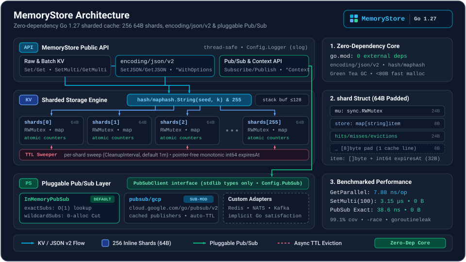
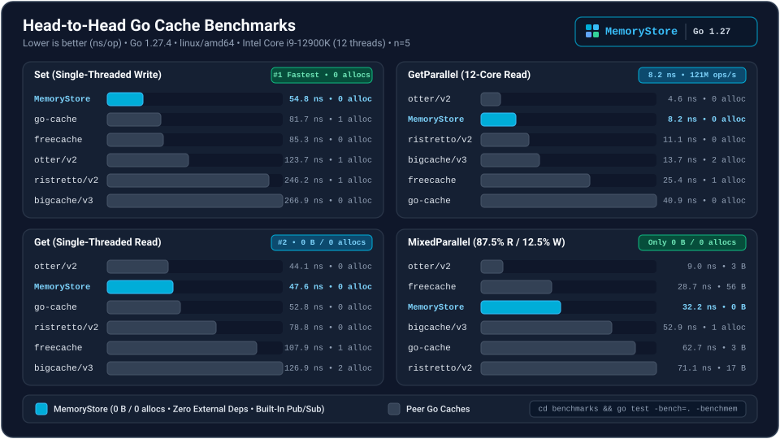

# MemoryStore

[](https://github.com/BryceWayne/MemoryStore/actions/workflows/go.yml)
[](https://pkg.go.dev/github.com/BryceWayne/MemoryStore/memorystore)
[](https://goreportcard.com/report/github.com/BryceWayne/MemoryStore)
[](https://go.dev/doc/go1.27)
[](LICENSE)

**MemoryStore** is a **zero-dependency**, high-performance, thread-safe, sharded in-memory key-value cache and pluggable Pub/Sub library for Go. Built for **Go 1.27+**, it combines cache-line padded sharded storage with per-shard atomic metrics, automatic TTL expiration, standard-library **`encoding/json/v2`** serialization, stack-optimized batch operations, and a provider-agnostic Publish/Subscribe interface.

---

## Table of Contents

- [Features](#features)
- [Requirements](#requirements)
- [Installation](#installation)
- [Quick Start](#quick-start)
- [Usage](#usage)
  - [JSON Serialization (`encoding/json/v2`)](#json-serialization-encodingjsonv2)
  - [Batch Operations](#batch-operations)
  - [Metrics & Monitoring](#metrics--monitoring)
  - [Publish / Subscribe (Pluggable Backends)](#publish--subscribe-pluggable-backends)
  - [Configuration, Logging & Lifecycle](#configuration-logging--lifecycle)
- [API Overview](#api-overview)
- [Repository Layout](#repository-layout)
- [Architecture](#architecture)
- [Performance & Benchmarks](#performance--benchmarks)
- [Development & Testing](#development--testing)
- [Contributing](#contributing)
- [Security](#security)
- [Changelog](#changelog)
- [License](#license)

---

## Features

- **Zero External Dependencies (Core):** The root `github.com/BryceWayne/MemoryStore` module uses **only the Go 1.27 standard library**. Optional broker adapters (`pubsub/gcp`, `pubsub/azure`, `pubsub/redis`, `pubsub/nats`, `pubsub/aws`, `pubsub/kafka`) live in standalone sub-modules.
- **High-Throughput Sharded Concurrency:** 256 inline, 64-byte cache-line aligned shards with per-shard `sync.RWMutex` locks, per-shard `atomic.Int64` metrics, and zero-allocation `hash/maphash` routing (`8.2 ns/op` 12-core parallel reads, `#1` single-threaded writes).
- **Distributed Cache Invalidation Backplane:** Opt in via `Config.InvalidationTopic` to keep local RAM caches coherent across pods over GCP Pub/Sub, Azure Service Bus, Redis/Valkey, NATS, AWS SNS + SQS, Apache Kafka / Redpanda, or any `PubSubClient` — with automatic per-instance UUID echo suppression.
- **Go 1.27 Generic Methods & Stampede Protection:** Typed `GetJSONAs[T]` and singleflight-protected `GetOrLoad` / `GetOrLoadJSON[T]` coalesce concurrent cache misses into a single upstream load.
- **Bounded Capacity & Eviction Callbacks:** Optional `Config.MaxItems`, `Config.MaxBytes` (volatile-TTL sampled eviction with zero overhead on unbounded caches), and lock-free `Config.OnEvict` callbacks.
- **Standard Library JSON v2:** Built on Go 1.27's `encoding/json/v2` with strict RFC 8259 defaults and optional `json.Options` customization (`SetJSONWithOptions` / `GetJSONWithOptions`).
- **Zero-Allocation Batch Writes:** `SetMulti` and `GetMulti` group keys per shard with stack-allocated scratch buffers (for batches up to 128 keys).
- **Pluggable, Context-Aware Pub/Sub:** Provider-agnostic `PubSubClient` interface (using only stdlib types) supporting In-Memory (O(1) exact routing + zero-alloc wildcard matching), Google Cloud Pub/Sub v2 (`pubsub/gcp`), Azure Service Bus (`pubsub/azure`), Redis / Valkey (`pubsub/redis`), NATS / JetStream (`pubsub/nats`), AWS SNS + SQS (`pubsub/aws`), Apache Kafka / Redpanda (`pubsub/kafka`), or custom brokers.
- **Library-Friendly Logging:** Silent by default (`slog.DiscardHandler`); opt in via `Config.Logger`.
- **Verified Quality:** Tested under `-race` and Go 1.27's `goroutineleak` profiler.

---

## Requirements

- **Go 1.27** or later

---

## Installation

Install the zero-dependency core module:

```bash
go get github.com/BryceWayne/MemoryStore/memorystore
```

*(Optional)* Install a standalone Pub/Sub adapter:

```bash
# Google Cloud Pub/Sub (v2)
go get github.com/BryceWayne/MemoryStore/pubsub/gcp

# Azure Service Bus
go get github.com/BryceWayne/MemoryStore/pubsub/azure

# Redis / Valkey
go get github.com/BryceWayne/MemoryStore/pubsub/redis

# NATS / JetStream
go get github.com/BryceWayne/MemoryStore/pubsub/nats

# AWS SNS + SQS
go get github.com/BryceWayne/MemoryStore/pubsub/aws

# Apache Kafka / Redpanda (pure Go, zero cgo)
go get github.com/BryceWayne/MemoryStore/pubsub/kafka
```

---

## Quick Start

```go
package main

import (
	"fmt"
	"log"
	"time"

	"github.com/BryceWayne/MemoryStore/memorystore"
)

func main() {
	store := memorystore.NewMemoryStore()
	defer func() {
		if err := store.Stop(); err != nil {
			log.Printf("failed to stop store: %v", err)
		}
	}()

	if err := store.Set("greeting", []byte("Hello, World!"), time.Minute); err != nil {
		log.Fatal(err)
	}

	if value, ok := store.Get("greeting"); ok {
		fmt.Println(string(value))
	}
}
```

See [examples/basic/main.go](examples/basic/main.go) for a complete runnable program (`make run-example`).

---

## Usage

### JSON Serialization (`encoding/json/v2`)

MemoryStore uses Go 1.27's standard library `encoding/json/v2` for `SetJSON` and `GetJSON`:

```go
type User struct {
	Name    string    `json:"name"`
	Email   string    `json:"email"`
	Created time.Time `json:"created,omitzero"`
}

store := memorystore.NewMemoryStore()
defer store.Stop()

user := User{Name: "Alice", Email: "alice@example.com", Created: time.Now()}
if err := store.SetJSON("user:123", &user, time.Hour); err != nil {
	log.Fatal(err)
}

var retrieved User
exists, err := store.GetJSON("user:123", &retrieved)
if err != nil {
	log.Fatal(err)
}
if exists {
	log.Printf("User: %+v", retrieved)
}
```

> **Note on `encoding/json/v2` defaults:** `encoding/json/v2` marshals nil slices as `[]` and nil maps as `{}`, rejects duplicate JSON object member names, and rejects invalid UTF-8 by default. Passing a pointer (`&user`) to `SetJSON` avoids copying struct values during marshaling.

#### Custom Options & Legacy `encoding/json` v1 Compatibility

Use `SetJSONWithOptions` and `GetJSONWithOptions` to pass any `encoding/json/v2` or `encoding/json/jsontext` options — including `encoding/json.DefaultOptionsV1()` when legacy v1 semantics are required:

```go
import (
	jsonv1 "encoding/json"
	json "encoding/json/v2"
)

// Deterministic map key ordering on marshal
err := store.SetJSONWithOptions("cfg", cfgMap, time.Hour, json.Deterministic(true))

// Reject unknown JSON fields on unmarshal
exists, err := store.GetJSONWithOptions("cfg", &cfg, json.RejectUnknownMembers(true))

// Opt in to legacy encoding/json v1 semantics
err = store.SetJSONWithOptions("legacy", payload, time.Hour, jsonv1.DefaultOptionsV1())
```

### Go 1.27 Generic Methods & Stampede Protection (`GetOrLoad`)

Use Go 1.27 generic methods for ergonomic typed reads and singleflight-protected cache population (coalescing concurrent misses for the same key into a single upstream load):

```go
// Typed JSON read (Go 1.27 generic method)
user, ok, err := store.GetJSONAs[User]("user:123")

// Singleflight-protected typed JSON load (coalesces concurrent misses)
user, err = store.GetOrLoadJSON[User](ctx, "user:123", time.Hour, func(ctx context.Context) (User, error) {
	return db.FetchUser(ctx, "123")
})

// Raw-byte singleflight load
raw, err := store.GetOrLoad(ctx, "report:daily", 10*time.Minute, func(ctx context.Context) ([]byte, error) {
	return generateReport(ctx)
})
```

### Distributed Cache Invalidation (Multi-Pod Coherency)

Keep local RAM reads (~8 ns) coherent across multiple application pods over any `PubSubClient` (`pubsub/gcp`, `pubsub/azure`, `pubsub/redis`, `pubsub/nats`, `pubsub/aws`, `pubsub/kafka`, etc.) without a central cache server:

```go
store := memorystore.NewMemoryStoreWithConfig(memorystore.Config{
	PubSub:            pubsubClient,
	InvalidationTopic: "cache-invalidations",
})
defer store.Stop()

// Local Set, SetMulti, and Delete broadcast compact invalidation events tagged
// with store.InstanceID() so peer pods evict stale keys without self-echo loops.
```

### Bounded Capacity & Eviction Callbacks

Guard against unbounded memory growth with soft global `MaxItems` / `MaxBytes` limits (zero overhead when unset) and an `OnEvict` hook invoked outside shard locks:

```go
store := memorystore.NewMemoryStoreWithConfig(memorystore.Config{
	MaxItems: 100_000,
	MaxBytes: 256 * 1024 * 1024, // 256 MiB key+value payload budget
	OnEvict: func(key string, value []byte, reason memorystore.EvictReason) {
		// reason is EvictExpired, EvictCapacity, or EvictDeleted
	},
})
```

### Batch Operations

Group multiple reads or writes into a single per-shard lock pass:

```go
items := map[string][]byte{
	"key1": []byte("val1"),
	"key2": []byte("val2"),
}
if err := store.SetMulti(items, time.Minute); err != nil {
	log.Fatal(err)
}

results := store.GetMulti([]string{"key1", "key2"})
```

### Metrics & Monitoring

Inspect live, per-shard aggregated statistics at any time:

```go
metrics := store.GetMetrics()
log.Printf(
	"Items=%d Hits=%d Misses=%d Evictions=%d",
	metrics.Items, metrics.Hits, metrics.Misses, metrics.Evictions,
)
```

### Publish / Subscribe (Pluggable Backends)

#### Built-In In-Memory Broker (Default)

Provides **O(1)** lookup for exact topics and zero-allocation `:`-delimited wildcard matching (`user:*`, `orders:*:created`):

```go
store := memorystore.NewMemoryStore()
defer store.Stop()

msgs, err := store.Subscribe("user:*")
if err != nil {
	log.Fatal(err)
}

go func() {
	for msg := range msgs {
		log.Printf("Received: %s", string(msg))
	}
}()

if err := store.Publish("user:123", []byte("logged in")); err != nil {
	log.Fatal(err)
}

_ = store.Unsubscribe("user:*")
```

Context-aware variants (`SubscribeContext`, `PublishContext`, `UnsubscribeContext`) are also available for per-call cancellation and deadlines.

#### Plugging In Any External Broker (`PubSubClient`)

Any type implementing the four standard-library methods below automatically satisfies `memorystore.PubSubClient` without even importing `memorystore`:

```go
type PubSubClient interface {
	Subscribe(ctx context.Context, topic string) (<-chan []byte, error)
	Publish(ctx context.Context, topic string, message []byte) error
	Unsubscribe(ctx context.Context, topic string) error
	Close() error
}
```

#### Google Cloud Pub/Sub (`pubsub/gcp` sub-module)

```go
import (
	"context"
	"log"
	"time"

	"github.com/BryceWayne/MemoryStore/memorystore"
	"github.com/BryceWayne/MemoryStore/pubsub/gcp"
)

ctx := context.Background()
gcpClient, err := gcp.NewClient(ctx, "my-gcp-project-id")
if err != nil {
	log.Fatal(err)
}

store := memorystore.NewMemoryStoreWithConfig(memorystore.Config{
	PubSub:        gcpClient,
	PubSubTimeout: 5 * time.Second,
})
defer store.Stop()
```

#### Azure Service Bus (`pubsub/azure` sub-module)

Requires an Azure Service Bus **Standard** or **Premium** namespace (Topics & Subscriptions). Supports both Managed Identity / Entra ID (`azcore.TokenCredential`) and SAS connection strings, as well as ephemeral auto-managed or pre-provisioned least-privilege subscriptions:

```go
import (
	"log"
	"time"

	"github.com/Azure/azure-sdk-for-go/sdk/azidentity"
	"github.com/BryceWayne/MemoryStore/memorystore"
	"github.com/BryceWayne/MemoryStore/pubsub/azure"
)

cred, err := azidentity.NewDefaultAzureCredential(nil)
if err != nil {
	log.Fatal(err)
}

// Ephemeral auto-managed subscription (default, AutoDeleteOnIdle = 24h)
azureClient, err := azure.NewClient("my-ns.servicebus.windows.net", cred)
if err != nil {
	log.Fatal(err)
}

// Or for least-privilege RBAC (Data Sender/Receiver without admin permissions):
// azureClient, err := azure.NewClient(
//     "my-ns.servicebus.windows.net", cred,
//     azure.WithSubscriptionName("my-preprovisioned-sub"),
// )

store := memorystore.NewMemoryStoreWithConfig(memorystore.Config{
	PubSub:        azureClient,
	PubSubTimeout: 5 * time.Second,
})
defer store.Stop()
```

#### Redis / Valkey (`pubsub/redis` sub-module)

Backed by `go-redis/v9`'s `UniversalClient` for standalone Redis/Valkey, Redis Sentinel, and Redis Cluster topologies. Automatically routes exact topics via `SUBSCRIBE` and wildcard globs (`*`, `?`, `[`) via `PSUBSCRIBE`:

```go
import (
	"log"
	"time"

	"github.com/BryceWayne/MemoryStore/memorystore"
	"github.com/BryceWayne/MemoryStore/pubsub/redis"
	goredis "github.com/redis/go-redis/v9"
)

redisClient, err := redis.NewClient(&goredis.UniversalOptions{
	Addrs: []string{"127.0.0.1:6379"},
})
if err != nil {
	log.Fatal(err)
}

// Or wrap an existing caller-managed redis.UniversalClient:
// redisClient, err := redis.NewClientFromClient(existingClient)

store := memorystore.NewMemoryStoreWithConfig(memorystore.Config{
	PubSub:        redisClient,
	PubSubTimeout: 5 * time.Second,
})
defer store.Stop()
```

#### NATS / JetStream (`pubsub/nats` sub-module)

Supports Core NATS (`*` single-token and `>` multi-token dot-delimited wildcards), optional queue groups (`WithQueueGroup`), and optional JetStream durability (`WithJetStream`):

```go
import (
	"log"
	"time"

	"github.com/BryceWayne/MemoryStore/memorystore"
	"github.com/BryceWayne/MemoryStore/pubsub/nats"
)

natsClient, err := nats.NewClient("nats://127.0.0.1:4222")
if err != nil {
	log.Fatal(err)
}

// Or enable JetStream, queue groups, or wrap an existing *nats.Conn:
// natsClient, err := nats.NewClient("nats://127.0.0.1:4222", nats.WithJetStream("cache-events"))
// natsClient, err := nats.NewClient("nats://127.0.0.1:4222", nats.WithQueueGroup("cache-workers"))
// natsClient, err := nats.NewClientFromConn(existingConn) // import natsgo "github.com/nats-io/nats.go"

store := memorystore.NewMemoryStoreWithConfig(memorystore.Config{
	PubSub:        natsClient,
	PubSubTimeout: 5 * time.Second,
})
defer store.Stop()
```

#### AWS SNS + SQS (`pubsub/aws` sub-module)

Fans out messages via AWS SNS topics to SQS long-polling (`ReceiveMessage`). Supports ephemeral auto-managed SQS queues (default) or pre-provisioned least-privilege IAM resources (`WithQueueURL`, `WithTopicARN`):

```go
import (
	"context"
	"log"
	"time"

	"github.com/BryceWayne/MemoryStore/memorystore"
	"github.com/BryceWayne/MemoryStore/pubsub/aws"
	"github.com/aws/aws-sdk-go-v2/config"
)

ctx := context.Background()
cfg, err := config.LoadDefaultConfig(ctx, config.WithRegion("us-east-1"))
if err != nil {
	log.Fatal(err)
}

// Ephemeral auto-managed SQS queue per subscription (default)
awsClient, err := aws.NewClient(cfg)
if err != nil {
	log.Fatal(err)
}

// Or for least-privilege IAM (only sns:Publish, sqs:ReceiveMessage, sqs:DeleteMessage):
// awsClient, err := aws.NewClient(
//     cfg,
//     aws.WithTopicARN("arn:aws:sns:us-east-1:123456789012:cache-invalidation"),
//     aws.WithQueueURL("https://sqs.us-east-1.amazonaws.com/123456789012/pod-1-invalidation"),
// )

store := memorystore.NewMemoryStoreWithConfig(memorystore.Config{
	PubSub:        awsClient,
	PubSubTimeout: 5 * time.Second,
})
defer store.Stop()
```

#### Apache Kafka / Redpanda (`pubsub/kafka` sub-module)

Pure-Go (`CGO_ENABLED=0`) Kafka/Redpanda adapter backed by `franz-go` (`kgo`). Defaults to broadcast mode (isolated consumers starting at the latest log-end offset `AtEnd` so every pod receives new events) with optional shared consumer groups (`WithConsumerGroup`), TLS (`WithTLSConfig`), and SASL/SCRAM (`WithSCRAMSHA256`, `WithSCRAMSHA512`, `WithSASL`):

```go
import (
	"log"
	"time"

	"github.com/BryceWayne/MemoryStore/memorystore"
	"github.com/BryceWayne/MemoryStore/pubsub/kafka"
)

kafkaClient, err := kafka.NewClient([]string{"127.0.0.1:9092"})
if err != nil {
	log.Fatal(err)
}

// Or configure TLS, SCRAM authentication, or a shared consumer group:
// kafkaClient, err := kafka.NewClient(
//     []string{"broker-1:9093"},
//     kafka.WithTLSConfig(tlsCfg),
//     kafka.WithSCRAMSHA256("user", "password"),
//     kafka.WithConsumerGroup("worker-group"),
// )

store := memorystore.NewMemoryStoreWithConfig(memorystore.Config{
	PubSub:        kafkaClient,
	PubSubTimeout: 5 * time.Second,
})
defer store.Stop()
```

### Configuration, Logging & Lifecycle

```go
logger := slog.New(slog.NewJSONHandler(os.Stdout, nil))
store := memorystore.NewMemoryStoreWithConfig(memorystore.Config{
	PubSub:          customBroker,        // Defaults to InMemoryPubSub
	PubSubTimeout:   5 * time.Second,     // Default timeout for non-context Pub/Sub helpers
	CleanupInterval: 30 * time.Second,    // Background expiration sweep interval (default 1m)
	Logger:          logger,              // Defaults to slog.DiscardHandler (silent)
})
defer store.Stop()
```

- Items with `duration <= 0` expire immediately.
- Always call `store.Stop()` when shutting down to stop background workers, close the `PubSubClient`, and release memory. Multiple calls to `Stop()` are safe and idempotent.

---

## API Overview

Full API documentation is available on [pkg.go.dev](https://pkg.go.dev/github.com/BryceWayne/MemoryStore/memorystore).

| Method / Type | Description |
| :--- | :--- |
| `NewMemoryStore() *MemoryStore` | Creates a store with default settings (In-Memory Pub/Sub, silent logger) |
| `NewMemoryStoreWithConfig(Config) *MemoryStore` | Creates a store with custom `PubSub`, `PubSubTimeout`, `CleanupInterval`, `Logger` |
| `Set(key string, value []byte, duration time.Duration) error` | Stores raw bytes with a TTL |
| `Get(key string) ([]byte, bool)` | Retrieves raw bytes if present and unexpired |
| `Delete(key string)` | Removes a key |
| `SetJSON(key string, value any, duration time.Duration) error` | Marshals via `encoding/json/v2` and stores with a TTL |
| `SetJSONWithOptions(key, value, duration, opts...) error` | Marshals with custom `encoding/json/v2` options |
| `GetJSON(key string, dest any) (bool, error)` | Retrieves and unmarshals via `encoding/json/v2` |
| `GetJSONWithOptions(key, dest, opts...) (bool, error)` | Retrieves and unmarshals with custom `encoding/json/v2` options |
| `SetMulti(items map[string][]byte, duration time.Duration) error` | Batch-sets multiple keys grouped by shard |
| `GetMulti(keys []string) map[string][]byte` | Batch-gets multiple keys grouped by shard |
| `GetMetrics() StoreMetrics` | Returns `Items`, `Hits`, `Misses`, and `Evictions` |
| `Subscribe` / `SubscribeContext` | Subscribes to a topic or pattern |
| `Publish` / `PublishContext` | Publishes a message to matching subscribers |
| `Unsubscribe` / `UnsubscribeContext` | Cancels subscriptions for a topic |
| `SubscriberCount(pattern string) int` | Returns active subscriber count when backend implements `SubscriberCounter` |
| `NewInMemoryPubSub() *InMemoryPubSub` | Instantiates the built-in in-memory Pub/Sub broker directly |
| `Stop() error` / `IsStopped() bool` | Gracefully stops the store and checks lifecycle state |

---

## Repository Layout

```text
.
├── memorystore/        # Core zero-dependency cache, generic helpers & PubSubClient
├── pubsub/gcp/         # Standalone Go module for Google Cloud Pub/Sub (v2)
├── pubsub/azure/       # Standalone Go module for Azure Service Bus
├── pubsub/redis/       # Standalone Go module for Redis / Valkey Pub/Sub
├── pubsub/nats/        # Standalone Go module for NATS / JetStream
├── pubsub/aws/         # Standalone Go module for AWS SNS + SQS
├── pubsub/kafka/       # Standalone pure-Go module for Apache Kafka / Redpanda
├── benchmarks/         # Isolated head-to-head comparison benchmarks vs peer caches
├── docs/images/        # Architecture & benchmark SVG diagrams
├── examples/basic/     # Runnable usage example
├── Makefile            # Multi-module build, test, lint, and benchmark targets
└── .github/            # CI, release workflow, Dependabot, and issue/PR templates
```

---

## Architecture



---

## Performance & Benchmarks



### Head-to-Head Comparison (`benchmarks/`, Go 1.27.4, Intel Core i9-12900K, 12 threads, `n=5`)

| Library | `Set` | `Get` | `GetParallel` | `MixedParallel` (87.5% R / 12.5% W) | Allocations (all 4) |
| :--- | ---: | ---: | ---: | ---: | :---: |
| **MemoryStore** | **54.8 ns** (0 B) | **47.6 ns** (0 B) | **8.2 ns** (0 B) | **32.2 ns** (0 B) | **0 B / 0 allocs** |
| `otter/v2` | 123.7 ns (1 alloc) | 44.1 ns (0 B) | 4.6 ns (0 B) | 9.0 ns (3 B) | 0–1 allocs |
| `freecache` | 85.3 ns (0 B) | 107.9 ns (1 alloc) | 25.4 ns (1 alloc) | 28.7 ns (56 B) | 0–1 allocs |
| `go-cache` | 81.7 ns (1 alloc) | 52.8 ns (0 B) | 40.9 ns (0 B) | 62.7 ns (3 B) | 0–1 allocs |
| `bigcache/v3` | 266.9 ns | 126.9 ns (2 allocs) | 13.7 ns (2 allocs) | 52.9 ns (1 alloc) | 0–2 allocs |
| `ristretto/v2` | 246.2 ns (1 alloc) | 78.8 ns (2 B) | 11.1 ns (0 B) | 71.1 ns (17 B) | 0–1 allocs |

Reproduce head-to-head benchmarks via `make bench-compare` (see [benchmarks/README.md](benchmarks/README.md)).

### Internal Benchmarks (`benchstat`, `go1.27.4`, Intel Core i9-12900K)

| Benchmark | Time / op | Bytes / op | Allocs / op |
| :--- | ---: | ---: | ---: |
| `BenchmarkMemoryStore_Set` | 48.6 ns | 0 B | 0 |
| `BenchmarkMemoryStore_Get` | 40.9 ns | 0 B | 0 |
| `BenchmarkMemoryStore_GetParallel` | **7.88 ns** | 0 B | 0 |
| `BenchmarkMemoryStore_SetGetParallel` | 29.3 ns | 0 B | 0 |
| `BenchmarkMemoryStore_SetMulti` (100 keys) | **3.15 µs** | **0 B** | **0** |
| `BenchmarkMemoryStore_GetMulti` (100 keys) | **3.13 µs** | 5,464 B | 4 |
| `BenchmarkMemoryStore_SetJSON_Small` | 207.8 ns | 48 B | 1 |
| `BenchmarkMemoryStore_GetJSON_Small` | 251.6 ns | **0 B** | **0** |
| `BenchmarkMemoryStore_SetJSON_Complex` | 1.73 µs | 512 B | 8 |
| `BenchmarkMemoryStore_GetJSON_Complex` | 2.21 µs | 976 B | 17 |
| `BenchmarkMemoryStore_PubSub` (wildcard) | 80.7 ns | 0 B | 0 |
| `BenchmarkMemoryStore_PubSub_ExactManyTopics` (100 topics) | **38.6 ns** | **0 B** | **0** |

Reproduce locally:

```bash
make bench
# Or with benchstat-friendly repetition:
go test -run='^$' -bench=. -benchmem -count=6 ./memorystore
```

---

## Development & Testing

Use the included [Makefile](Makefile):

```bash
make all          # Run clean, fmt, vet, lint, test, and build across all modules
make test         # Run tests with -race and coverage across all modules
make bench        # Run benchmarks with memory stats
make lint         # Run golangci-lint (v2) across all modules
make vet          # Run go vet across all modules
make fmt          # Format code with go fmt
make coverage     # Generate HTML coverage report
make run-example  # Run examples/basic
make help         # List all targets
```

---

## Contributing

Contributions are welcome and appreciated! Please read our [Contributing Guide](CONTRIBUTING.md) and [Code of Conduct](CODE_OF_CONDUCT.md) before opening an issue or pull request.

- Report bugs via the [Bug Report template](.github/ISSUE_TEMPLATE/bug_report.md).
- Propose enhancements or new `PubSubClient` adapters via the [Feature Request template](.github/ISSUE_TEMPLATE/feature_request.md).
- Target all pull requests against the `root` branch.

---

## Security

Please report security vulnerabilities responsibly as described in [SECURITY.md](SECURITY.md). Do not open public issues for security bugs.

---

## Changelog

See [CHANGELOG.md](CHANGELOG.md) for a history of changes and release notes.

---

## License

This project is licensed under the MIT License — see [LICENSE](LICENSE) for details.
