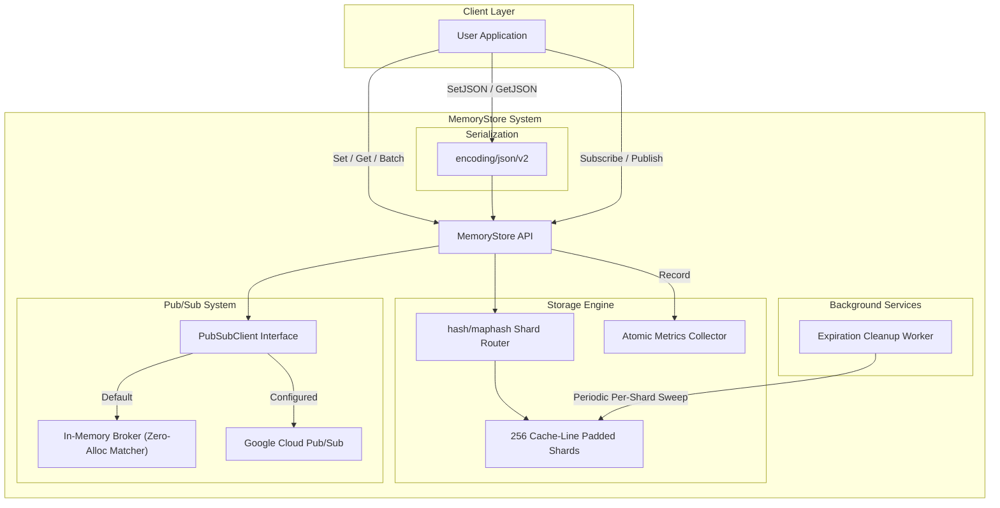
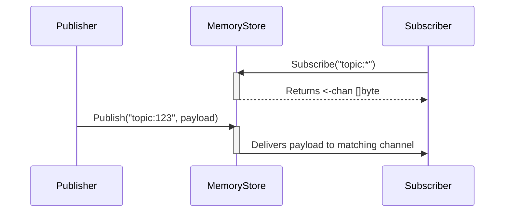

# MemoryStore

[](https://github.com/BryceWayne/MemoryStore/actions/workflows/go.yml)
[](https://pkg.go.dev/github.com/BryceWayne/MemoryStore/memorystore)
[](https://goreportcard.com/report/github.com/BryceWayne/MemoryStore)
[](https://go.dev/doc/go1.27)
[](LICENSE)

**MemoryStore** is a high-performance, thread-safe, sharded in-memory key-value cache and Pub/Sub library for Go. Built for **Go 1.27+**, it combines cache-line padded sharded storage, automatic TTL expiration, standard-library **`encoding/json/v2`** serialization, low-allocation batch operations, built-in metrics, and a pluggable Publish/Subscribe layer (In-Memory and Google Cloud Pub/Sub).

---

## Table of Contents

- [Features](#features)
- [Requirements](#requirements)
- [Installation](#installation)
- [Quick Start](#quick-start)
- [Usage](#usage)
  - [JSON Serialization (`encoding/json/v2`)](#json-serialization-encodingjsonv2)
  - [Batch Operations](#batch-operations)
  - [Metrics & Monitoring](#metrics--monitoring)
  - [Publish / Subscribe](#publish--subscribe)
  - [Expiration & Graceful Shutdown](#expiration--graceful-shutdown)
- [API Overview](#api-overview)
- [Architecture](#architecture)
- [Performance & Benchmarks](#performance--benchmarks)
- [Development & Testing](#development--testing)
- [Contributing](#contributing)
- [Security](#security)
- [Changelog](#changelog)
- [License](#license)

---

## Features

- **Sharded Concurrency:** 256 inline, cache-line padded shards with per-shard `sync.RWMutex` locking and zero-allocation hardware-accelerated hashing (`hash/maphash`).
- **Automatic Expiration:** Pointer-free monotonic TTL timestamps with lazy expiration checks and periodic background cleanup.
- **Standard Library JSON v2:** Built on Go 1.27's `encoding/json/v2` with zero external JSON dependencies, strict RFC 8259 defaults, and optional `json.Options` customization (`SetJSONWithOptions` / `GetJSONWithOptions`).
- **Low-Allocation Batch Operations:** `SetMulti` and `GetMulti` group keys per shard in a single flat pass to minimize lock acquisitions and heap allocations.
- **Pluggable Pub/Sub:** Provider-agnostic `PubSubClient` interface supporting a zero-allocation wildcard In-Memory broker by default and Google Cloud Pub/Sub out of the box.
- **Built-In Metrics:** Thread-safe atomic counters (`Items`, `Hits`, `Misses`, `Evictions`).
- **Clean Lifecycle Management:** Idempotent `Stop()` with goroutine cleanup verified against Go 1.27's `goroutineleak` profiler and `-race` detector.

---

## Requirements

- **Go 1.27** or later

---

## Installation

```bash
go get github.com/BryceWayne/MemoryStore/memorystore
```

---

## Quick Start

```go
package main

import (
	"fmt"
	"log"
	"time"

	"github.com/BryceWayne/MemoryStore/memorystore"
)

func main() {
	store := memorystore.NewMemoryStore()
	defer func() {
		if err := store.Stop(); err != nil {
			log.Printf("failed to stop store: %v", err)
		}
	}()

	if err := store.Set("greeting", []byte("Hello, World!"), time.Minute); err != nil {
		log.Fatal(err)
	}

	if value, ok := store.Get("greeting"); ok {
		fmt.Println(string(value))
	}
}
```

---

## Usage

### JSON Serialization (`encoding/json/v2`)

MemoryStore uses Go 1.27's standard library `encoding/json/v2` for `SetJSON` and `GetJSON`:

```go
type User struct {
	Name    string    `json:"name"`
	Email   string    `json:"email"`
	Created time.Time `json:"created,omitzero"`
}

store := memorystore.NewMemoryStore()
defer store.Stop()

user := User{Name: "Alice", Email: "alice@example.com", Created: time.Now()}
if err := store.SetJSON("user:123", &user, time.Hour); err != nil {
	log.Fatal(err)
}

var retrieved User
exists, err := store.GetJSON("user:123", &retrieved)
if err != nil {
	log.Fatal(err)
}
if exists {
	log.Printf("User: %+v", retrieved)
}
```

> **Note on `encoding/json/v2` defaults:** `encoding/json/v2` marshals nil slices as `[]` and nil maps as `{}`, rejects duplicate JSON object member names, and rejects invalid UTF-8 by default. Passing a pointer (`&user`) to `SetJSON` avoids copying struct values during marshaling.

#### Custom Options & Legacy `encoding/json` v1 Compatibility

Use `SetJSONWithOptions` and `GetJSONWithOptions` to pass any `encoding/json/v2` or `encoding/json/jsontext` options — including `encoding/json.DefaultOptionsV1()` if you need legacy v1 behavior:

```go
import (
	jsonv1 "encoding/json"
	json "encoding/json/v2"
)

// Deterministic map key ordering on marshal
err := store.SetJSONWithOptions("cfg", cfgMap, time.Hour, json.Deterministic(true))

// Reject unknown JSON fields on unmarshal
exists, err := store.GetJSONWithOptions("cfg", &cfg, json.RejectUnknownMembers(true))

// Opt in to legacy encoding/json v1 semantics when needed
err = store.SetJSONWithOptions("legacy", payload, time.Hour, jsonv1.DefaultOptionsV1())
```

### Batch Operations

Group multiple reads or writes into a single per-shard lock pass:

```go
items := map[string][]byte{
	"key1": []byte("val1"),
	"key2": []byte("val2"),
}
if err := store.SetMulti(items, time.Minute); err != nil {
	log.Fatal(err)
}

results := store.GetMulti([]string{"key1", "key2"})
```

### Metrics & Monitoring

Inspect live store statistics at any time:

```go
metrics := store.GetMetrics()
log.Printf(
	"Items=%d Hits=%d Misses=%d Evictions=%d",
	metrics.Items, metrics.Hits, metrics.Misses, metrics.Evictions,
)
```

### Publish / Subscribe

#### In-Memory Pub/Sub (Default)

Supports exact topics as well as `:`-delimited wildcard patterns (for example, `user:*` or `orders:*:created`):

```go
store := memorystore.NewMemoryStore()
defer store.Stop()

msgs, err := store.Subscribe("user:*")
if err != nil {
	log.Fatal(err)
}

go func() {
	for msg := range msgs {
		log.Printf("Received: %s", string(msg))
	}
}()

if err := store.Publish("user:123", []byte("logged in")); err != nil {
	log.Fatal(err)
}

_ = store.Unsubscribe("user:*")
```

#### Google Cloud Pub/Sub

Configure GCP Pub/Sub explicitly via `Config`:

```go
store := memorystore.NewMemoryStoreWithConfig(memorystore.Config{
	GCPProjectID: "my-gcp-project-id",
})
defer store.Stop()
```

Or set the `GOOGLE_CLOUD_PROJECT` environment variable before calling `memorystore.NewMemoryStore()`:

```bash
export GOOGLE_CLOUD_PROJECT=my-gcp-project-id
```

If GCP Pub/Sub initialization fails (for example, missing credentials in local development), MemoryStore logs the error and gracefully falls back to the In-Memory broker.

### Expiration & Graceful Shutdown

- Items with `duration <= 0` expire immediately.
- Expired entries are filtered out on `Get` / `GetMulti` and periodically evicted by a background cleanup worker (every 1 minute).
- Always call `store.Stop()` when shutting down to stop background workers, close Pub/Sub subscriptions, and release memory. Multiple calls to `Stop()` are safe and idempotent.

---

## API Overview

Full API documentation is available on [pkg.go.dev](https://pkg.go.dev/github.com/BryceWayne/MemoryStore/memorystore).

| Method / Type | Description |
| :--- | :--- |
| `NewMemoryStore() *MemoryStore` | Creates a store (auto-detects `GOOGLE_CLOUD_PROJECT` for GCP Pub/Sub) |
| `NewMemoryStoreWithConfig(Config) *MemoryStore` | Creates a store with explicit configuration |
| `Set(key string, value []byte, duration time.Duration) error` | Stores raw bytes with a TTL |
| `Get(key string) ([]byte, bool)` | Retrieves raw bytes if present and unexpired |
| `Delete(key string)` | Removes a key |
| `SetJSON(key string, value any, duration time.Duration) error` | Marshals via `encoding/json/v2` and stores with a TTL |
| `SetJSONWithOptions(key, value, duration, opts...) error` | Marshals with custom `encoding/json/v2` options |
| `GetJSON(key string, dest any) (bool, error)` | Retrieves and unmarshals via `encoding/json/v2` |
| `GetJSONWithOptions(key, dest, opts...) (bool, error)` | Retrieves and unmarshals with custom `encoding/json/v2` options |
| `SetMulti(items map[string][]byte, duration time.Duration) error` | Batch-sets multiple keys grouped by shard |
| `GetMulti(keys []string) map[string][]byte` | Batch-gets multiple keys grouped by shard |
| `GetMetrics() StoreMetrics` | Returns `Items`, `Hits`, `Misses`, and `Evictions` |
| `Subscribe(topic string) (<-chan []byte, error)` | Subscribes to a topic or wildcard pattern |
| `Publish(topic string, message []byte) error` | Publishes a message to matching subscribers |
| `Unsubscribe(topic string) error` | Cancels subscriptions for a topic |
| `SubscriberCount(pattern string) int` | Returns active subscriber count (In-Memory Pub/Sub) |
| `Stop() error` / `IsStopped() bool` | Gracefully stops the store and checks lifecycle state |

---

## Architecture



### Pub/Sub Data Flow



---

## Performance & Benchmarks

MemoryStore is engineered for low latency and minimal GC pressure on Go 1.27+:

- **Go 1.27 runtime advantages:** Size-specialized small allocations (<80 B), default Green Tea GC, stack-allocated slice backing stores, and container-aware `GOMAXPROCS`.
- **Zero-allocation shard hashing:** `hash/maphash.String` with power-of-2 bitmasking.
- **Reduced false sharing:** 256 inline shards padded to 64-byte cache lines.
- **Pointer-free expiration:** Monotonic `int64` nanosecond offsets shrink each cache entry from 48 B to 32 B and cut GC pointer scanning.
- **Flat batch grouping:** Intrusive-index shard bucketing eliminates per-shard map allocations in `SetMulti` / `GetMulti`.
- **Zero-allocation topic matching:** `strings.Cut` loop in `InMemoryPubSub`.

Representative `benchstat` results (`go1.27.4`, `linux/amd64`, Intel Core i9-12900K, `n=6`, `-benchtime=500ms`):

| Benchmark | Time / op | Bytes / op | Allocs / op |
| :--- | ---: | ---: | ---: |
| `BenchmarkMemoryStore_Set` | 49.4 ns | 0 B | 0 |
| `BenchmarkMemoryStore_Get` | 42.2 ns | 0 B | 0 |
| `BenchmarkMemoryStore_GetParallel` | 27.0 ns | 0 B | 0 |
| `BenchmarkMemoryStore_SetGetParallel` | 33.0 ns | 0 B | 0 |
| `BenchmarkMemoryStore_SetMulti` (100 keys) | 4.02 µs | 4,864 B | 1 |
| `BenchmarkMemoryStore_GetMulti` (100 keys) | 3.62 µs | 6,360 B | 5 |
| `BenchmarkMemoryStore_SetJSON_Small` | 210.8 ns | 48 B | 1 |
| `BenchmarkMemoryStore_GetJSON_Small` | 242.4 ns | 0 B | 0 |
| `BenchmarkMemoryStore_SetJSON_Complex` | 1.67 µs | 512 B | 8 |
| `BenchmarkMemoryStore_GetJSON_Complex` | 2.29 µs | 976 B | 17 |
| `BenchmarkMemoryStore_PubSub` | 78.4 ns | 0 B | 0 |

Reproduce locally:

```bash
make bench
# Or with benchstat-friendly repetition:
go test -run='^$' -bench=. -benchmem -count=6 ./memorystore
```

---

## Development & Testing

Use the included [Makefile](Makefile):

```bash
make all        # Run clean, fmt, vet, lint, test, and build
make test       # Run tests with -race and coverage
make bench      # Run benchmarks with memory stats
make lint       # Run golangci-lint (v2)
make vet        # Run go vet
make fmt        # Format code with go fmt
make coverage   # Generate HTML coverage report
make help       # List all targets
```

---

## Contributing

Contributions are welcome and appreciated! Please read our [Contributing Guide](CONTRIBUTING.md) and [Code of Conduct](CODE_OF_CONDUCT.md) before opening an issue or pull request.

- Report bugs via the [Bug Report template](.github/ISSUE_TEMPLATE/bug_report.md).
- Propose enhancements via the [Feature Request template](.github/ISSUE_TEMPLATE/feature_request.md).
- Target all pull requests against the `root` branch.

---

## Security

Please report security vulnerabilities responsibly as described in [SECURITY.md](SECURITY.md). Do not open public issues for security bugs.

---

## Changelog

See [CHANGELOG.md](CHANGELOG.md) for a history of changes and release notes.

---

## License

This project is licensed under the MIT License — see [LICENSE](LICENSE) for details.
